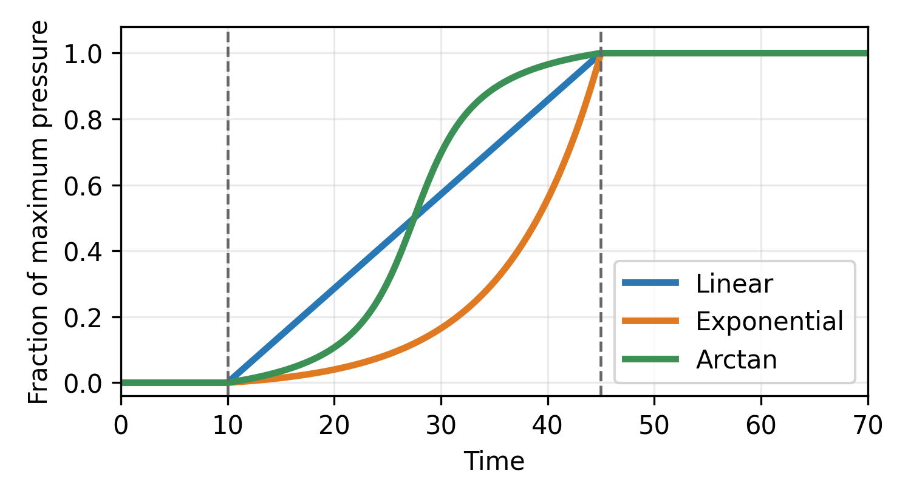
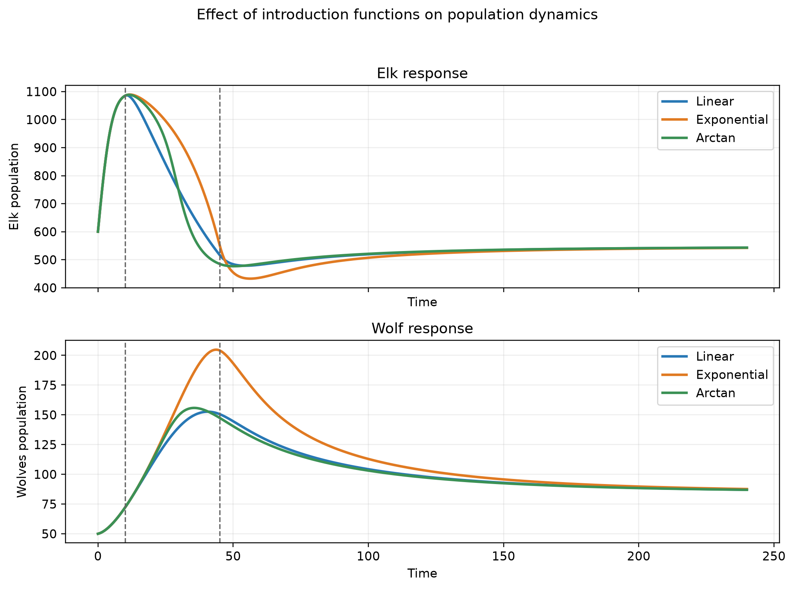
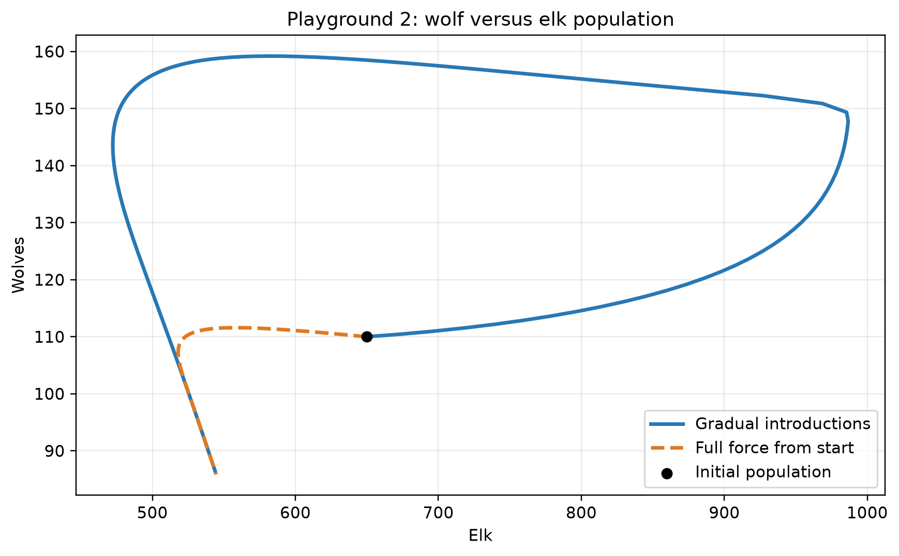

# Frontier expansion

One of our first ideas was to model a frontier expansion, with farmers and hunters settling a new area. We represented the introduction of these pressures as a function that begins at 0% and rises to 100%. We compared three schedules: a linear baseline, an exponential curve that starts slowly and gains momentum, and an arctangent curve that eases in and slows as it approaches full pressure.

Let `u = clip((t - t0) / D, 0, 1)`, where `t0` is the start time and `D` is the duration. The schedules are

- Linear: `f(u) = u`.
- Exponential: `f(u) = (exp(4u) - 1) / (exp(4) - 1)`.
- Arctangent: `f(u) = [atan(4(2u - 1)) + atan(4)] / [2 atan(4)]`.

We expected a gradual introduction might preserve the ecosystem, while a fast introduction might damage it. In this model run, the schedule changes the transient response, but the elk and wolf populations approach the same final equilibrium once both pressures reach their shared maximum. Thus, introduction speed changes when the system settles, rather than the final equilibrium. This is a result for the model and parameter values shown, not a general ecological prediction.

The phase-plane comparison below reproduces the gradual-versus-full-force experiment configured in `Norman/playground2.ipynb`, including its initial population, one-time-unit smoothstep ramp, and farmer-removal parameter override.

All plots are generated by `generate_figures.py` as PNG files. The script uses the repository `ODESystem` class for numerical integration and its plotting methods to construct the figures. The equation snapshot and illustrative parameter values are the ones bundled in `Norman/repo_model_snapshot.py`; the first two figures start at `(600 elk, 50 wolves)`, with maximum farmer and hunter pressures of 40 and 25 and a ramp from `t = 10` through `t = 45`. The Playground 2 figure uses that notebook's settings: `(650 elk, 110 wolves)`, a one-time-unit smoothstep ramp, and `c_FW = 0.0009`.

Wolf predation in these simulations uses the Beddington–DeAngelis functional response
`a * E * W / (1 + a * h * E + c * W)`. The same consumed-elk term reduces elk and contributes to wolf growth; `h` represents handling time and `c` predator interference.
